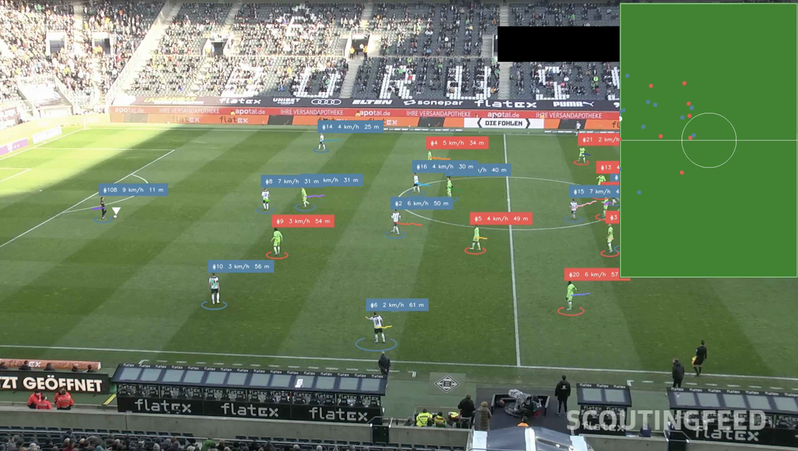

# Football Analysis – Real-time Player Tracking

Computer vision pipeline that detects players, tracks them across frames,
classifies team membership by jersey color, estimates camera movement, and
measures each player's speed and distance covered — all from a broadcast
football video.

---



*Player detection with team classification, per-player speed (km/h) and
distance covered (m), motion trails, and bird's-eye minimap.*

---

## Features

| Feature | Method |
|---------|--------|
| Player & ball detection | YOLOv8 fine-tuned on football dataset |
| Multi-object tracking | ByteTrack (built into YOLO) |
| Team classification | KMeans on CIELAB jersey color |
| Camera movement | Shi-Tomasi corners + Lucas-Kanade optical flow |
| Coordinate transform | Homography (pixel → real-world metres) |
| Speed & distance | Rolling-average with camera-movement correction |
| Visualization | supervision library (ellipses, trails, labels, minimap) |

---

## Project Structure

```
realtime-object-detection/
├── assets/
│   ├── example_result.png  # Sample output frame
│   └── videos/             # Input videos (gitignored – see GDPR notice)
├── docs/
│   ├── architecture.md     # System design and data-flow diagram
│   ├── modules.md          # Per-module reference
│   ├── training.md         # Fine-tuning guide (Colab + local)
│   └── usage.md            # Installation and CLI guide
├── notebooks/
│   └── football_training_colab.ipynb  # Google Colab training notebook
├── src/
│   ├── tracking/
│   │   └── tracker.py      # YOLOv8 + ByteTrack wrapper
│   ├── camera/
│   │   └── stabilizer.py   # Optical-flow camera movement estimation
│   ├── field/
│   │   └── perspective.py  # Homography – pixel ↔ metres
│   ├── team/
│   │   └── classifier.py   # KMeans jersey-color team assignment
│   ├── metrics/
│   │   └── speed_distance.py  # Speed (km/h) and distance (m) per player
│   ├── annotation/
│   │   └── visualizer.py   # Frame rendering with supervision
│   └── pipeline.py         # Orchestrator – ties all modules together
├── tests/
│   └── test_team_classifier.py
├── main.py                 # CLI entry point
├── train.py                # Fine-tuning entry point
├── config.yaml             # All parameters in one place
└── requirements.txt
```

---

## Quick Start

```bash
# 1. Create and activate virtual environment
python -m venv .venv
source .venv/bin/activate

# 2. Install dependencies
pip install -r requirements.txt

# 3. Run the pipeline
python main.py --input assets/videos/sample_match.mp4
```

The annotated video is written next to the input file as
`sample_match_analysed.mp4`.

For full configuration options see [docs/usage.md](docs/usage.md).

---

## How It Works

```
Video frame
    │
    ▼
PlayerTracker          detects players and ball, assigns stable IDs
    │
    ▼
CameraStabilizer       measures how much the camera has panned this frame
    │
    ▼
TeamClassifier         assigns each new player ID to team 0 or 1
    │
    ▼
SpeedDistanceTracker   corrects positions for camera movement, converts to
                       metres, computes rolling speed and total distance
    │
    ▼
FrameAnnotator         draws ellipses, trails, labels, and minimap
    │
    ▼
Output video
```

Detailed design notes: [docs/architecture.md](docs/architecture.md)
Per-module documentation: [docs/modules.md](docs/modules.md)
Fine-tuning guide: [docs/training.md](docs/training.md)

---

## Fine-tuning

The default COCO-pretrained weights detect a generic "person" class.
The fine-tuned model distinguishes **ball**, **goalkeeper**, **player**,
and **referee**, and ignores spectators outside the pitch.

Training runs on a free T4 GPU in Google Colab in ~20 minutes using the
provided notebook (`notebooks/football_training_colab.ipynb`).

**Dataset:**
[Football Players Detection – Roboflow Universe](https://universe.roboflow.com/roboflow-jvuqo/football-players-detection-3zvbc/dataset/1)
(CC BY 4.0, 612 training images)

See [docs/training.md](docs/training.md) for the full guide.

---

## Configuration

All parameters live in `config.yaml`. Key options:

```yaml
model:
  weights: runs/football/weights/best.pt  # fine-tuned
  tracker: bytetrack                       # bytetrack | botsort

field:
  corners:                 # pixel coords of the 4 pitch corners
    - [142, 98]            # set these from your actual video for
    - [1138, 98]           # accurate speed / distance values
    - [1138, 620]
    - [142, 620]
```

---

## Potential Improvements

- **Field corner auto-detection** — use line segmentation models (e.g. SoccerNet) to automatically detect pitch boundary lines and compute the homography without manual corner annotation.
- **Re-ID across camera cuts** — integrate an appearance embedding model (e.g. OSNet) to re-identify players after the camera cuts to a different angle.
- **Larger training dataset** — more annotated images and multiple stadiums would improve generalisation to different broadcast styles and lighting conditions.
- **Pose estimation** — add a keypoint model (e.g. YOLOv8-pose) to extract skeletal data for biomechanical analysis (sprint mechanics, jump height, body angle).
- **Ball trajectory smoothing** — apply a Kalman filter to the ball position to interpolate through frames where it is occluded or motion-blurred.
- **Automatic team colour discovery** — cluster jersey colours from the first few seconds of video rather than relying on a fixed two-team assumption, to handle edge cases like cup finals with unexpected kit combinations.

---

## Design Compared to Reference Implementation

| Area | Reference | This project |
|------|-----------|--------------|
| Color space | RGB KMeans | CIELAB KMeans (perceptually uniform) |
| Tracking | Custom SORT wrapper | ByteTrack via YOLO (fewer ID switches) |
| Visualization | Manual cv2 drawing | supervision library (composable annotators) |
| Configuration | Hardcoded constants | Single `config.yaml` |
| Camera movement | Lucas-Kanade on full frame | Background-strip-only optical flow |
| Code structure | Script-oriented | Module per concern, dataclass configs |
| Fine-tuning | Not included | Colab notebook + `train.py` |

---

## GDPR Notice

Video footage of football matches may contain images of identifiable
individuals and therefore constitutes **personal data** under GDPR
(EU 2016/679). Biometric data (body shape, gait) is **special-category
data** under Article 9.

**Before using this system you must ensure:**

- You have a valid legal basis for processing (e.g. explicit consent of
  the persons filmed, or a legitimate-interest assessment).
- Footage is stored securely and not shared without authorisation.
- Data is retained only as long as necessary for the stated purpose.
- Individuals can exercise their rights (access, erasure) upon request.

This software does **not** store personal data permanently. It reads a
video file, computes derived metrics, and writes an annotated video. The
responsibility for handling source footage in compliance with applicable
law rests with the operator.

Video files in `assets/videos/` are excluded from version control via
`.gitignore` to avoid accidentally publishing footage containing personal data.

---

## Requirements

- Python 3.10+
- See `requirements.txt` for package versions
- GPU optional but recommended for real-time processing
